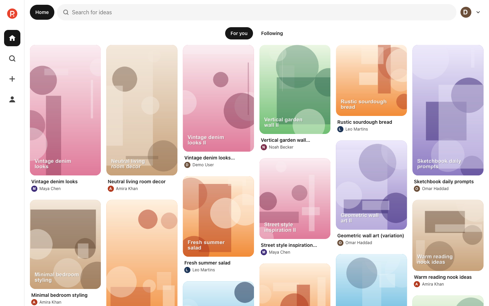
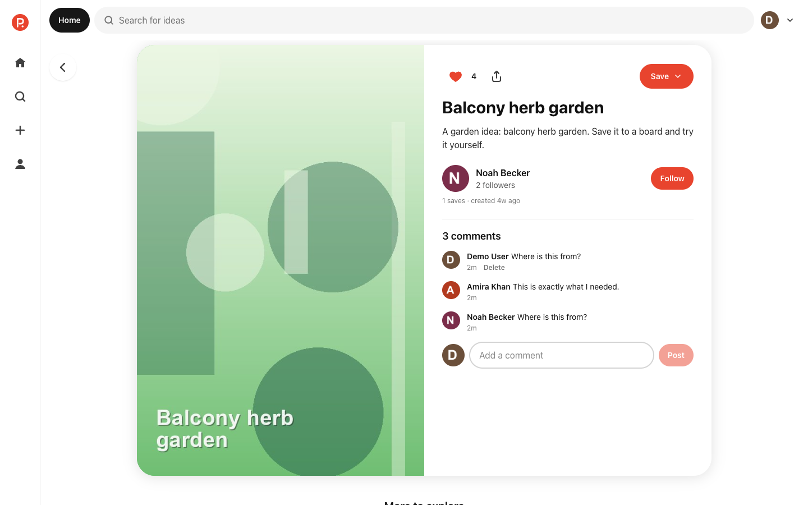
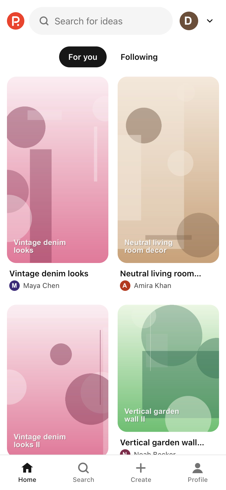

<div align="center">

# Pinspire

**A full-stack visual discovery app: find ideas, save them to boards, share them with others.**

Inspired by Pinterest-style discovery and built from scratch with Next.js, Laravel and MySQL.


</div>



<table>
  <tr>
    <td width="68%"></td>
    <td width="32%"></td>
  </tr>
  <tr>
    <td align="center"><sub>Pin detail: like, save to board, share, follow, comments</sub></td>
    <td align="center"><sub>Mobile layout</sub></td>
  </tr>
</table>

## Features

**Discover**
- Responsive masonry feed (2 to 7 columns) with infinite scroll and colour placeholders while images load
- "For you" and "Following" feeds
- Search with live suggestions, plus Pins / People / Boards results tabs
- "More to explore" related pins on every pin page

**Save and organise**
- Save any pin to a board from a quick picker, or create a new board inline
- Public and secret boards, with edit, delete and remove-pin actions
- Board covers built from the latest saved pins

**Create**
- Upload images by drag and drop or file picker (JPG, PNG, GIF, WebP, up to 10 MB) with a live preview
- Title, description, destination link and target board
- Edit or delete your own pins

**Social**
- Likes, comments (authors and pin owners can delete them) and share links
- Follow and unfollow creators, with follower / following lists
- Profiles with Created and Saved tabs, avatar upload, bio and website

**Quality**
- Server-side validation with field-level errors in the UI
- Ownership checks on every write (403), token auth (401), rate-limited login
- Loading, empty and error states throughout, plus toast feedback
- Desktop sidebar, tablet layout and mobile bottom navigation

## Tech stack

| Layer | Technology |
|---|---|
| Frontend | Next.js 16 (App Router), React 19, TypeScript, Tailwind CSS 4 |
| Backend | Laravel 13, PHP 8.5, Laravel Sanctum (bearer tokens) |
| Database | MySQL 8+ (InnoDB, FULLTEXT search) |
| API | REST / JSON, paginated |
| Images | Local `public` disk; dimensions and dominant colour computed with GD |

## Architecture

```
pinspire/
├── backend/            Laravel REST API
│   ├── app/Http/Controllers/Api/   Auth, Pins, Boards, Comments, Likes, Follows, Search, Users
│   ├── app/Http/Resources/         JSON shapes (viewer-aware: is_liked, is_saved, is_following)
│   ├── app/Models/                 User, Pin, Board, Comment
│   ├── app/Services/ImageService   upload storage, size and dominant colour
│   ├── database/migrations/        schema, indexes, FULLTEXT
│   └── database/seeders/           demo users, boards and generated artwork
├── frontend/           Next.js client
│   ├── src/app/                    routes: /, /pin/[id], /search, /[username], /[username]/[slug], /create, /settings, /login, /register
│   ├── src/components/             Masonry, PinCard, SaveMenu, AppShell, SearchBar, BoardCard, …
│   ├── src/context/                auth and toasts
│   └── src/lib/                    API client, types, infinite-scroll hook
└── docs/screenshots/
```

The masonry layout is computed in JavaScript. Each pin goes into the currently shortest column, and its height comes from the image dimensions stored by the API. Positions are known before the images load, so the grid never jumps.

## Getting started

### Prerequisites
- PHP 8.3+ with `pdo_mysql`, `gd`, `fileinfo`, `mbstring`
- Composer 2
- Node.js 20+ and npm
- MySQL 8+

### 1. Database
```sql
CREATE DATABASE pinspire CHARACTER SET utf8mb4 COLLATE utf8mb4_unicode_ci;
CREATE USER 'pinspire'@'127.0.0.1' IDENTIFIED BY 'choose-a-password';
GRANT ALL ON pinspire.* TO 'pinspire'@'127.0.0.1';
```

### 2. Backend (API on http://127.0.0.1:8000)
```bash
cd backend
composer install
cp .env.example .env          # set DB_PORT / DB_PASSWORD to match your MySQL
php artisan key:generate
php artisan migrate --seed    # schema + demo data
php artisan storage:link
php artisan serve --host=127.0.0.1 --port=8000
```

### 3. Frontend (app on http://localhost:3000)
```bash
cd frontend
npm install
cp .env.example .env.local    # NEXT_PUBLIC_API_URL=http://127.0.0.1:8000/api
npm run dev
```

### Demo accounts
After seeding, log in as `demo@pinspire.test` with password `password123`. Six more creators are seeded with the same password: `amira`, `leo`, `sana`, `noah`, `maya`, `omar` (all `@pinspire.test`). These are local demo credentials only.

### Environment variables

| File | Variable | Purpose |
|---|---|---|
| `backend/.env` | `DB_*` | MySQL connection |
| `backend/.env` | `FRONTEND_URL` | Allowed CORS origin(s), comma-separated |
| `backend/.env` | `FILESYSTEM_DISK=public` | Where uploads are stored |
| `frontend/.env.local` | `NEXT_PUBLIC_API_URL` | Base URL of the Laravel API |

## API reference

All endpoints are under `/api` and return JSON. Send `Authorization: Bearer <token>` for authenticated routes. Lists are paginated with `?page=` and `?per_page=` (max 50).

| Method | Endpoint | Auth | Description |
|---|---|:-:|---|
| POST | `/auth/register` · `/auth/login` | | Create account / log in, returns a token |
| GET · POST | `/auth/me` · `/auth/logout` | ✓ | Current user / revoke token |
| POST | `/me` | ✓ | Update profile (multipart, optional `avatar`) |
| GET | `/pins` | | Feed (`?feed=following` requires auth) |
| GET | `/pins/{id}` · `/pins/{id}/related` | | Pin detail / related pins |
| POST · PATCH · DELETE | `/pins` · `/pins/{id}` | ✓ | Create (multipart `image`) / edit / delete own pin |
| POST · DELETE | `/pins/{id}/like` | ✓ | Like / unlike |
| GET · POST | `/pins/{id}/comments` | GET public | List / add comments |
| DELETE | `/comments/{id}` | ✓ | Delete (comment author or pin owner) |
| GET | `/users/{username}` · `/pins` · `/boards` | | Profile, created pins, boards |
| GET | `/users/{username}/boards/{slug}` · `/boards/{id}/pins` | | Board and its pins |
| POST · PATCH · DELETE | `/boards` · `/boards/{id}` | ✓ | Create / edit / delete own board |
| POST · DELETE | `/boards/{id}/pins/{pinId}` | ✓ | Save / remove a pin |
| POST · DELETE | `/users/{username}/follow` | ✓ | Follow / unfollow |
| GET | `/users/{username}/followers` · `/following` | | Follower lists |
| GET | `/search/pins` · `/search/users` · `/search/boards` · `/search/suggest` | | Search (`?q=`) |

Errors follow Laravel conventions: `422` with an `errors` object for validation, `401` unauthenticated, `403` not the owner, `404` not found.

## Data model

| Table | Key columns | Notes |
|---|---|---|
| `users` | `username` (unique), `email` (unique), `avatar_path`, `bio`, `website` | |
| `pins` | `user_id`, `title`, `description`, `link`, `image_*`, `dominant_color`, counters | FULLTEXT(`title`, `description`); index on `(user_id, created_at)` |
| `boards` | `user_id`, `name`, `slug`, `is_private` | unique `(user_id, slug)` and `(user_id, name)` |
| `board_pin` | `board_id`, `pin_id` | unique pair |
| `comments` | `pin_id`, `user_id`, `body` | index on `(pin_id, created_at)` |
| `likes` | `pin_id`, `user_id` | unique pair |
| `follows` | `follower_id`, `following_id` | unique pair |

All foreign keys cascade on delete. Like, comment and save counts are stored on `pins` and updated transactionally.

## Testing

Every workflow was tested end to end in a browser against the real API and MySQL:
- register and log in, including validation errors
- browse the feed, search, open a pin
- upload an image and create a pin
- like, comment and delete a comment, follow a creator
- create a board, save a pin to it, remove it, rename the board, delete the board
- edit a pin, delete a pin, edit a profile with an avatar
- the Following feed, log out
- mobile (375 px) and tablet (768 px) layouts

```bash
cd frontend && npm run lint && npm run build
cd backend && php artisan route:list --path=api
```

## Roadmap
- Image resizing and responsive `srcset`, CDN storage
- Personalised ranking for the "For you" feed
- Email verification and password reset
- Notifications for follows, comments and saves
- Automated feature and E2E test suites in CI

## Disclaimer
Pinspire is an independent learning project. It is not affiliated with, endorsed by, or connected to Pinterest, Inc. The seed images are abstract artwork generated by the seeder.
